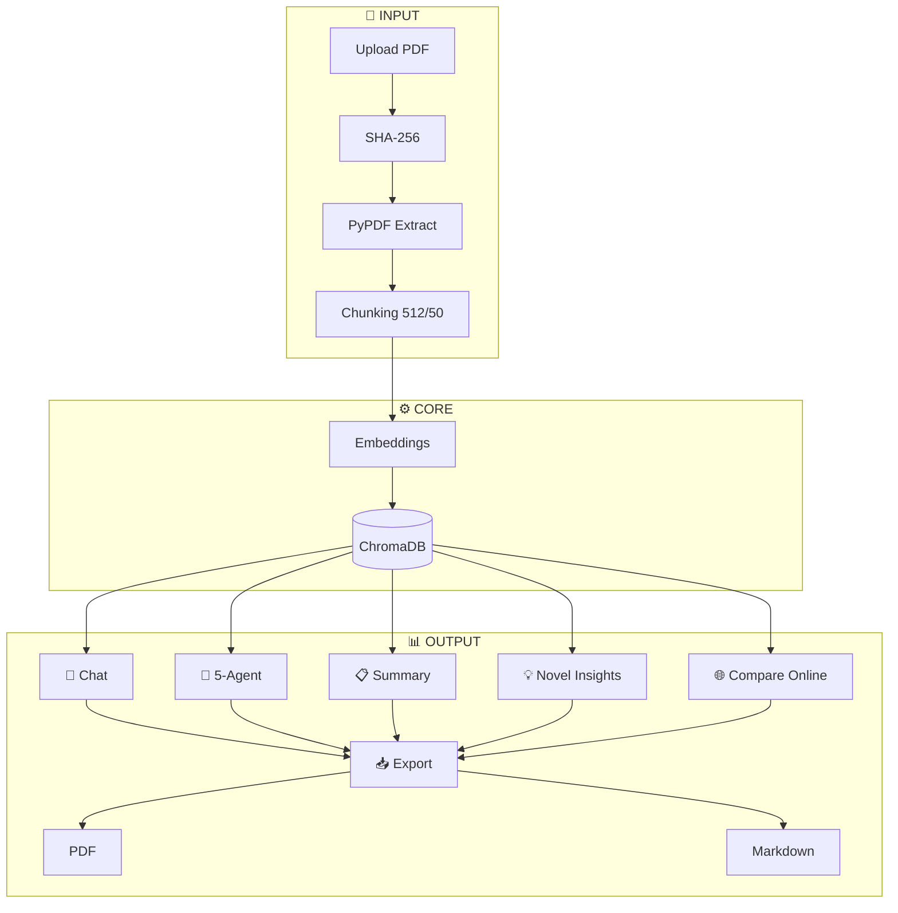

# ScrutinAI — AI Research Gap Finder

[](https://opensource.org/licenses/MIT)
[](https://www.python.org/downloads/)
[](https://fastapi.tiangolo.com)
[](https://groq.com)
[](https://www.trychroma.com)
[](https://render.com)
[](https://vercel.com/new/clone?repository-url=https%3A%2F%2Fgithub.com%2FAkash-Sare03%2FAI_Research_Gap_Finder&env=GROQ_API_KEY,LLM_MODEL,VERCEL_SUPPORT_LARGE_FUNCTIONS)

> **Bridge the known, discover the unknown.**  
> ScrutinAI is an AI-powered academic research assistant and multi-agent scientific discovery platform. Upload any research paper (PDF) to instantly discover unexplored research gaps, detect hidden assumptions, chat with exact source citations, compare with online literature, and run an autonomous 5-agent scientific debate that formulates new breakthrough hypotheses.

---

## 🌟 Key Features

| Feature | Description |
| :--- | :--- |
| 🤖 **5-Agent Autonomous Discovery** | A virtual scientific lab where 5 AI agents (**Concept Mapper**, **Idea Theorist**, **Peer Referee**, **Self-Correction Lead**, and **Blueprint Architect**) debate, challenge, and refine new breakthrough hypotheses beyond the original paper. |
| 🔍 **Academic Critique & Gap Finding** | Automatically extracts **explicit limitations** (with author quotes and page numbers), **inferred methodological flaws**, **prioritized research gaps** (High/Med/Low), and **actionable improvements**. |
| 🎓 **Plain-English Summary** | Translates dense academic jargon into clear, simple language with problem breakdowns and real-world takeaways for students and non-experts. |
| 💡 **'New to the World' Discoveries** | Discovers paradigm shifts, cross-domain transfers (e.g. biology to AI), structural flaws, and unexplored technical combinations across any scientific domain. |
| 🌐 **Live Literature Comparison** | Searches scholarly repositories (**arXiv, PubMed, IEEE, Semantic Scholar**) with strict noise filters to show what external literature covers that the uploaded paper missed. |
| 💬 **Grounded RAG Chat** | Ask any question about your papers. Answers are retrieved via **Hybrid Search (Vector + BM25)** with exact quote snippets, chunk IDs, and page numbers. |

---

## 🏗️ Architecture & Workflow



---

## 📖 Features in Detail

**1. 5-Agent Autonomous Scientific Discovery**
- Simulates an entire peer review panel and research lab using 5 collaborative AI agents:
  - **Concept Mapper:** Maps core methods, assumptions, and domain taxonomy.
  - **Idea Theorist:** Formulates speculative, high-impact hypotheses.
  - **Peer Referee:** Ruthlessly audits for flaws, feasibility, and prior art.
  - **Self-Correction Lead:** Iteratively resolves referee criticisms and tightens claims.
  - **Blueprint Architect:** Synthesizes an experimental blueprint ready for execution.

**2. Academic Critique & Gap Finding**
- Deeply inspects methodology, sample size, benchmark constraints, and algorithmic assumptions.
- Extracts explicit quotes with page numbers and infers hidden vulnerabilities.
- Prioritizes research opportunities by feasibility and impact (High / Medium / Low).

**3. Grounded RAG Chat**
- Uses **Hybrid Search (Vector Similarity + BM25 Keyword Search)** with Reciprocal Rank Fusion.
- Cites exact paragraph quotes and page numbers for every answer.
- Prevents hallucinations through strict context verification.

**4. Live Literature Comparison**
- Searches live academic repositories (arXiv, PubMed, IEEE, Semantic Scholar).
- Discovers state-of-the-art work published after or outside the paper's scope.
- Pinpoints unexplored opportunities where literature has moved ahead.

**5. User Isolation & Authentication**
- Secure session-based authentication with personal workspaces.
- Isolated paper collections, vector embeddings, and search history per user.
- Supports custom user Groq API keys and guest quota mode.

**6. Multi-Format Report Export**
- Download publication-grade executive summaries and gap analyses:
  - **PDF Report** — Beautifully formatted with professional typography.
  - **Markdown Report** — Ready for GitHub, Notion, or Obsidian.

**7. Plain-English Summary**
- Translates dense mathematical and academic jargon into plain English.
- Breaks down complex papers for students, founders, and interdisciplinary researchers.

**8. 'New to the World' Discoveries**
- Formulates novel research opportunities beyond the paper:
  - **Paradigm Shifts** — Unconventional framings.
  - **Cross-Domain Transfers** — Applying ideas from other fields.
  - **Structural Flaws** — Critical blind spots in existing frameworks.

---

## 🚀 Quick Start (Local Setup)

### 1. Clone the Repository
```bash
git clone https://github.com/Akash-Sare03/AI_Research_Gap_Finder.git
cd AI_Research_Gap_Finder
```

### 2. Create Virtual Environment & Install Dependencies
```bash
# Windows
python -m venv venv
.\venv\Scripts\Activate.ps1

# macOS / Linux
python3 -m venv venv
source venv/bin/activate

# Install requirements
pip install -r requirements.txt
```

### 3. Configure API Key
Create a `.env` file from the example:
```bash
cp .env.example .env     # On Windows: copy .env.example .env
```
Add your free Groq API Key:
```env
GROQ_API_KEY=gsk_your_groq_api_key_here
LLM_MODEL=qwen/qwen3.8-27b
```

### 4. Run the Application
```bash
python run_app.py
```
Open your browser at:
- 💻 **Web App:** [http://localhost:8000](http://localhost:8000)
- 📖 **Interactive API Docs:** [http://localhost:8000/docs](http://localhost:8000/docs)

---

## 🌐 Free Cloud Deployment

### Option 1: Deploy on Vercel (Free 1-Click / GitHub Import)

This repository includes a production-ready `vercel.json` and serverless entrypoint `api/index.py`.

[](https://vercel.com/new/clone?repository-url=https%3A%2F%2Fgithub.com%2FAkash-Sare03%2FAI_Research_Gap_Finder&env=GROQ_API_KEY,LLM_MODEL,VERCEL_SUPPORT_LARGE_FUNCTIONS)

**Steps to Deploy on Vercel:**
1. Push your code to your GitHub repository.
2. Go to **[vercel.com/new](https://vercel.com/new)** and click **Import** next to `AI_Research_Gap_Finder`.
3. Under **Environment Variables**, add:
   - `GROQ_API_KEY`: Your free Groq API key (from [console.groq.com](https://console.groq.com))
   - `LLM_MODEL`: `qwen/qwen3.8-27b` (or preferred model)
   - `VERCEL_SUPPORT_LARGE_FUNCTIONS`: `1`
4. Click **Deploy**. Vercel will build and provision your app with a free global HTTPS `.vercel.app` URL!

### Option 2: Deploy on Render (Free Blueprint)

Deploy using the included `render.yaml` specification:
1. Push to GitHub.
2. In the **[Render Dashboard](https://dashboard.render.com/)**, select **New +** > **Blueprint**.
3. Select your repository. Render will automatically read `render.yaml`, install dependencies, and launch `python run_app.py`.
4. Enter your `GROQ_API_KEY` in the Render environment variables tab.

---

## 🔄 Automated CI/CD Pipeline

Every push and pull request to `main` automatically triggers the GitHub Actions workflow (`.github/workflows/ci-cd.yml`):
- **Code Checkout:** Checks out branch on Ubuntu runner.
- **Python Setup:** Sets up Python 3.11 with pip caching.
- **Flake8 Linting:** Validates syntax, prevents undefined variables, and enforces code standards across `backend`, `api`, and `tests`.
- **Smoke Tests:** Automatically runs `tests/test_smoke.py` verifying config defaults, FastAPI routes, Vercel serverless entrypoint, `/api/health`, and citation extraction.
- **Zero-Downtime Deployment:** Automatically pings Render deploy hook (if `RENDER_DEPLOY_HOOK_URL` secret is configured).

---

## 🛠️ Tech Stack

- **Backend:** FastAPI, Uvicorn, LangChain, LangGraph, Pydantic, Python-Multipart
- **Inference & AI:** Groq API (`qwen/qwen3.8-27b`, `openai/gpt-oss-120b`)
- **Embeddings & Search:** HuggingFace `sentence-transformers/all-MiniLM-L6-v2`, ChromaDB, BM25Okapi
- **PDF & Export:** PyPDF, PDFPlumber, ReportLab (with clean typography sanitization)
- **Frontend:** Vanilla HTML5, Modern CSS3 Glassmorphism, FontAwesome 6, Lucide Icons (zero build step)
- **Deployment:** Vercel (Edge CDN + Serverless Functions), Render (Containerized Web Service), GitHub Actions (CI/CD)

---

## 📜 License

Distributed under the MIT License. Free for academic, personal, and commercial use.
